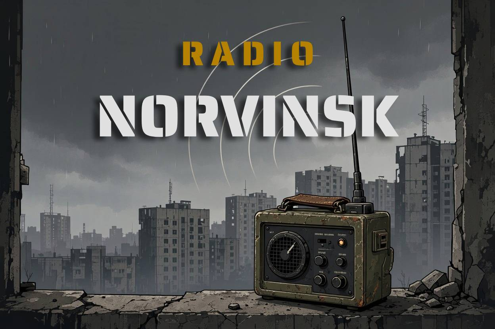

# SPT.RadioNorvinsk

[](https://github.com/McReaper/SPT.RadioNorvinsk/releases)



Server mod for **SPT 4.1.6 + Fika** that gives your server a radio host. **Radio Norvinsk** announces the notable moments of your friends' sessions in a Discord channel, in the voice of a calm local radio with a dry joke now and then, and never notifies anyone.

Server-side only: players install nothing.

> 📻 So, I'm told there's a crowd on Customs: Reapy, Dima and Kolya. It's going to get noisy.
>
> 📻 Head, eyes, for Kolya on Customs. The helmet couldn't do a thing.
>
> 📻 Big news on Customs: Reshala isn't answering anymore. We owe that to Reapy, from 87 m.
>
> 📻 Dima logs off after 2h14. The bitcoin farm, meanwhile, keeps running.

## What it posts

| Event | When | Switch |
|---|---|---|
| Connection | A player's game logs in with their profile. | `events.connect` |
| Disconnection | A player quits the game, or a game that dropped stays gone for `reconnectGraceMinutes`. The message gives the session's length. | `events.disconnect` |
| Raid start | A PMC raid starts: one message for the whole Fika squad, with the map and the in-raid time. | `events.raidStart` |
| Death | A player dies in a PMC raid: killer and what they were (scav, raider, boss...), weapon, body part, map, time in raid. The cause shows when it isn't the killer's bullet (bleeding, fall, mine...). Missing in action counts as a death. | `events.death` |
| Extraction | A player extracts from a PMC raid, run-throughs included. | `events.extraction` |
| Level up | A player gains a level, in a raid or out of it (quest rewards). The prestige shows once the player has one. | `events.levelUp` |
| Boss kill | A player kills a boss (Goons included) in a PMC raid: weapon, distance, body part. | `events.bossKill` |

Raid starts, deaths and boss kills come with a small card of facts. Connections, extractions and level-ups are a single line. Scav raids are ignored entirely.

Quitting the game from its menu ends the session at once. A game that drops without quitting (crash, lost connection, slow PC) and comes back within the grace delay stays in the same session, and nothing is posted either way.

Deaths get lines picked for the situation when one applies, from the most specific to the plain one: suicide (own grenade), friendly fire, fall, bleeding, explosion, killed by a boss, within the first 2 minutes, head-eyes, by a scav.

**No pings, no notifications.** Every message goes out with Discord's *suppress notifications* flag and an empty `allowed_mentions`. Nobody gets pinged, not even by a nickname like `@everyone`.

## Requirements

- SPT 4.1.6
- Fika 2.4.x. The mod hooks Fika's server, so SPT refuses to load it without Fika.
- A Discord channel where you can create a webhook.

## Install

1. Download `RadioNorvinsk-<version>.zip` from the [releases](https://github.com/McReaper/SPT.RadioNorvinsk/releases) and extract it into your SPT folder, the one that holds `SPT_Runtime`. The mod lands in `SPT_Runtime/user/mods/RadioNorvinsk/`.
2. Start the server once. It creates `config/config.json` in the mod's folder and asks, in the console, for a webhook URL. Until it has one, the radio stays off.
3. In Discord, open the channel's settings > *Integrations* > *Webhooks* > *New Webhook*, copy its URL and paste it as `webhookUrl`.
4. Restart the server. The console prints:

```
[Radio Norvinsk] On the air, in 'en'.
```

The webhook URL is a secret: anyone who has it can post in the channel.

To give the radio its face, set `persona.avatarUrl` to `https://raw.githubusercontent.com/McReaper/SPT.RadioNorvinsk/main/docs/media/avatar.png`.

Fika has a Discord webhook of its own, in `fika.jsonc`. Leave it off: it would announce raid starts a second time.

To update, extract the new zip over the old one. Your `config/config.json` is kept, and completed with any new settings.

## Configuration

`config/config.json`, created with these defaults and read when the server starts. Comments are allowed.

When an update brings new settings, the next start adds them to your file with their defaults and lists them in the console. Your values stay as they are, but the file's comments are lost in that rewrite. Otherwise the mod leaves the file alone.

| Key | Default | Meaning |
|---|---|---|
| `webhookUrl` | `""` | Discord webhook to post to. Empty: the radio stays off. |
| `language` | `"en"` | A file name in `locales/`, without `.json`. |
| `persona.name` | `"Radio Norvinsk"` | Name shown on each message. |
| `persona.avatarUrl` | `""` | Public image URL shown on each message. Empty: the webhook's own avatar. |
| `events.connect` | `true` | Post connections. |
| `events.disconnect` | `true` | Post disconnections. |
| `events.raidStart` | `true` | Post PMC raid starts. |
| `events.death` | `true` | Post deaths and missing in action. |
| `events.extraction` | `true` | Post extractions. |
| `events.levelUp` | `true` | Post level-ups. |
| `events.bossKill` | `true` | Post boss kills. |
| `reconnectGraceMinutes` | `10` | How long a game that dropped without quitting can be gone and still be in the same session. |

Discord keeps each avatar it has fetched for a given URL. After changing the image behind the same URL, add `?v=2` (then `?v=3`...) to the URL so Discord fetches it again.

Each message is logged in the server console, with Discord's response time:

```
[Radio Norvinsk] Posted death.headEyes (Kolya) (142 ms).
```

## Languages

`en` (default) and `fr` ship with the mod. To add one, copy `locales/en.json` to `locales/<code>.json`, translate it and set `language` to `<code>`. Any key the file lacks is said in English. Updates replace `en.json` and `fr.json`: put your own lines in a file of your own.

Each key under `lines` holds several variants. The radio picks one at random, never the same one twice in a row. Placeholders:

| Key | Placeholders |
|---|---|
| `connect` | `{player}` |
| `disconnect` | `{player}`, `{duration}` |
| `raidStartSolo`, `raidStartSquad` | `{player}` (first of the squad), `{squad}`, `{count}`, `{map}`, `{mapAt}`, `{time}` |
| `death`, `death.<situation>` | `{player}`, `{killer}`, `{boss}`, `{weapon}`, `{map}`, `{mapAt}`, `{raidTime}` |
| `mia` | `{player}`, `{map}`, `{mapAt}`, `{raidTime}` |
| `extract`, `extractRunThrough` | `{player}`, `{map}`, `{mapAt}`, `{raidTime}` |
| `levelUp` | `{player}`, `{level}` ("12", or "12 (prestige 1)" once the player has prestiged) |
| `bossKill` | `{player}`, `{boss}`, `{weapon}`, `{distance}`, `{map}`, `{mapAt}` |

`{mapAt}` is the map with its preposition, from `mapsAt` ("on Customs", "sur Customs"). The other sections (`maps`, `roles`, `bodyParts`, `headSegments`, `causes`, `labels`, `formats`) name what the game only gives as ids. Weapon names come from the game's own translations.

## Build

Requires the .NET 10 SDK and an SPT 4.1.6 install with Fika: the build references `FikaServer.dll`.

```sh
dotnet build -c Release -p:SPTPath="C:\SPT"
# add -p:InstallToSPT=true to copy the DLL and locales into SPT_Runtime/user/mods/RadioNorvinsk
# add -p:Dist=true to build dist/RadioNorvinsk-<version>.zip, the release archive
```

If the repo sits in `<SPT>/Development/SPT.RadioNorvinsk`, `SPTPath` can be omitted. The version is set once, in `RadioNorvinsk.csproj`.

## License

[MIT](LICENSE.md).
